# Cartes Ploc Cellar pour Home Assistant

\

[❗ README in ENGLISH 🇬🇧 ❗](README.md)

Affichage de tableau de bord Home Assistant (Frontend Lovelace), destiné à l'[intégration Ploc Cellar](https://github.com/MadMatt34/ha-ploc-cellar).\
🍷❤️

---

## 📦 Cartes fournies

### - 📊 Vue d'ensemble (`custom:ploc-cellar-card`)

**Synthèse, analyses et statistiques de la cave** : stock physique et reconstitué, occupation des casiers, diagnostics du stock et graphiques de répartition par couleur, région, appellation, millésime et format de bouteille.\
Les graphiques couvrent les références de vins connues ; les emplacements occupés dont le vin n'est pas résolu restent inclus dans les totaux physiques globaux et sont signalés séparément.\
La sélection d'un diagnostic en anomalie ouvre la liste des vins concernés.

| Stock | Diagnostics | Statistiques |
| :--: | :--: | :--: |
| 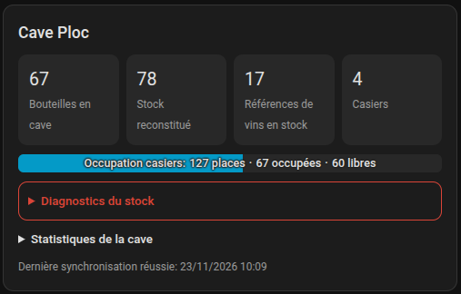 | 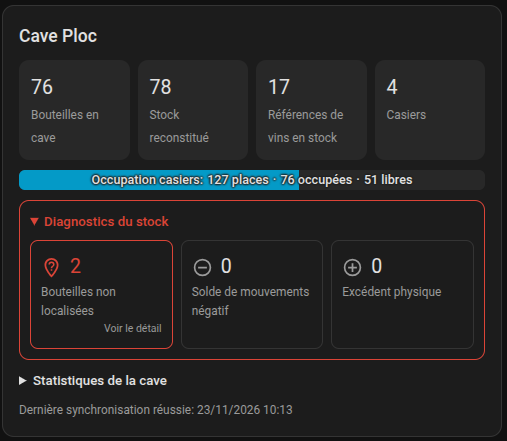 &nbsp; ↧ 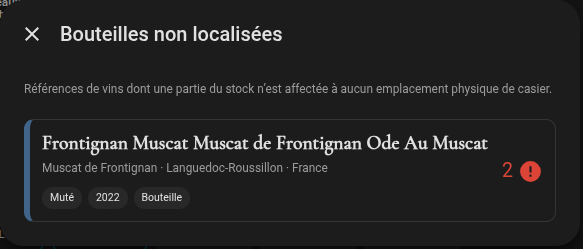 | 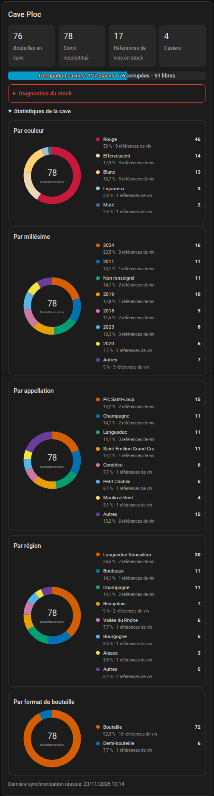 |

### - 🗃️ Inventaire (`custom:ploc-cellar-inventory-card`)

**Liste de vins** avec recherche, tri et pagination, filtres par couleur, région, appellation, millésime et accords mets-vins.\
Les filtres couleur, région, appellation et millésime proposent **Inconnu** pour retrouver les fiches incomplètes.\
La sélection d'un nom de vin ouvre sa fiche détaillée.

| Inventaire | Recherche, filtres et tris |
| :--: | :--: |
| 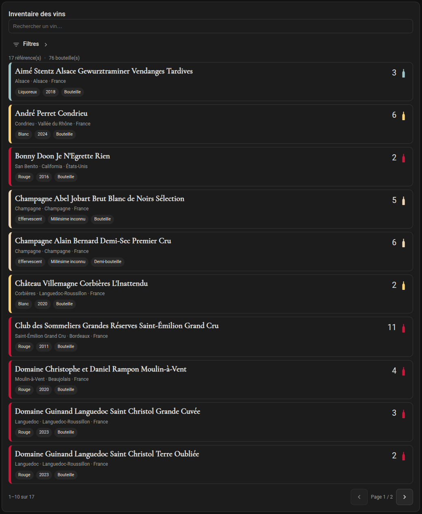 | 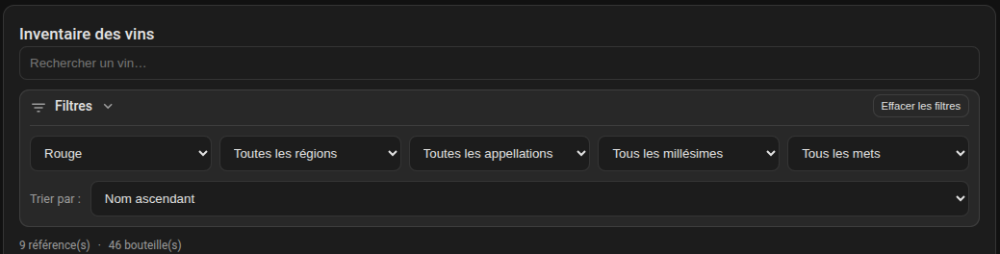 |

### - 🏷️ Casier (`custom:ploc-cellar-rack-card`)

Sélection du **casier et plan des emplacements** selon les coordonnées. Chaque emplacement occupé est représenté individuellement et reprend la couleur du vin lorsqu'elle est disponible.\
Sur les écrans de taille réduite, le plan passe automatiquement en grille compacte adaptée au tactile. Sur mobile, un premier toucher affiche l'infobulle de la bouteille ; un second toucher sur le même emplacement ouvre sa fiche détaillée.

| Grand écran | Mode compact |
| :--: | :--: |
| 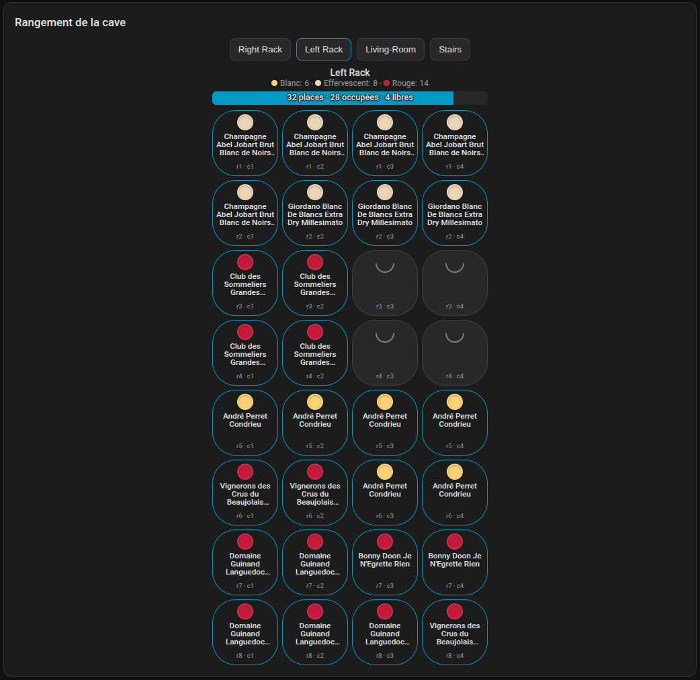 | 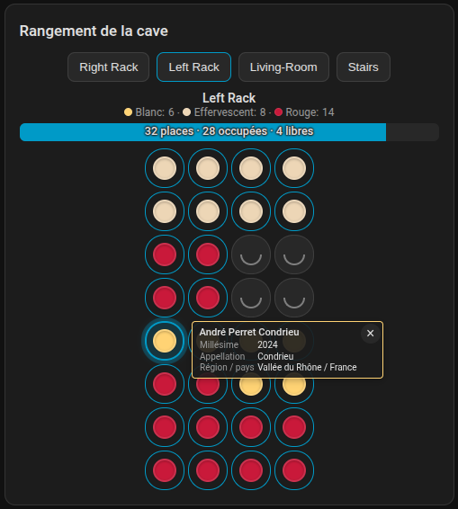 |

### - 🍷 Fiche vin

La **fiche détaillée du vin** est ouverte depuis une sélection dans l'inventaire, dans la liste des anomalies, ou dans un emplacement de casier. Elle présente des sections pour les caractéristiques, les accords mets-vins, les commentaires, les emplacements, et le stock.

> [!NOTE]
> Les mouvements de stock disposent d'une sous-section dédiée permettant d'identifier les anomalies. Un indicateur visible apparait en cas d'anomalie identifiée.\
> Les photos sont affichées lorsque l'intégration dispose d'une image mise en cache. La carte les récupère via une route Home Assistant authentifiée et ne contacte pas directement PLOUD. La fiche détaillée reste utilisable sans photo.

| Fiche | Caractéristiques | Mets-vin | Emplacements | Stock |
| :--: | :--: | :--: | :--: | :--: |
| 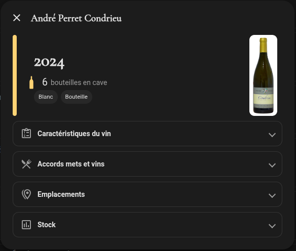 | 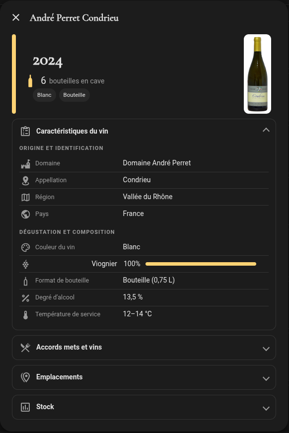 | 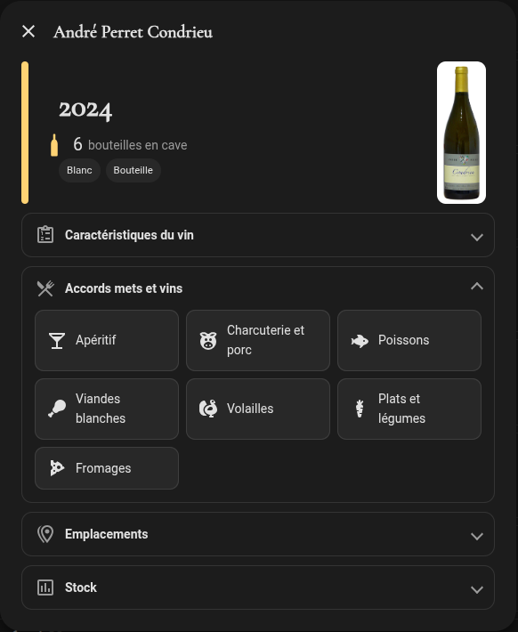 | 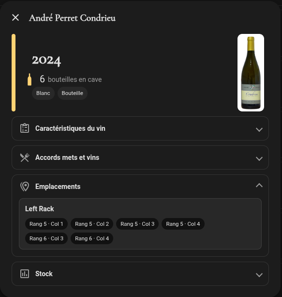 | 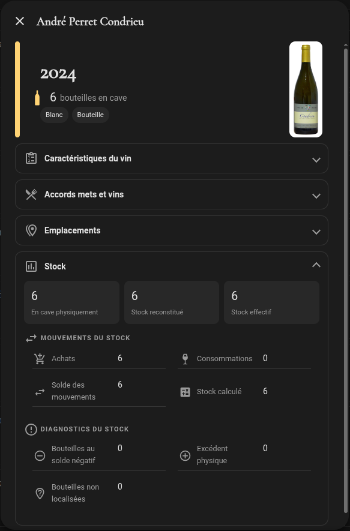 |

---

## 📋 Prérequis

- [x] **L'[intégration Ploc Cellar](https://github.com/MadMatt34/ha-ploc-cellar) doit être installée et configurée dans Home Assistant**.

- [x] Un navigateur pris en charge par l'interface Home Assistant est nécessaire.

---

## 🧩 Installation

### Option 1 : Installation via Marketplace (📌 recommandée)

1. Ouvrir le plugin de tableau de bord **Ploc Cellar Cards** dans **Marketplace** dans Home Assistant\
    

2. Cliquer sur **Installer**, puis passer aux étapes de configuration.

### Option 2 : Installation manuelle

1. Télécharger `dist/ploc-cellar-card.js` de ce dépôt.

2. Copier ce fichier dans `/config/www/community/ha-ploc-cellar-frontend/`.

3. Aller dans **Paramètres** → **Tableaux de bord**.\
   Cliquer sur le menu ⋮ avec trois points (en haut à droite). Puis, choisir **Ressources**.\
   

4. Cliquer sur le bouton **Ajouter une ressource** (en bas à droite).

5. Saisir l'**URL** `/local/community/ha-ploc-cellar-frontend/ploc-cellar-card.js`.\
   Choisir **Module JavaScript**.\
   Puis cliquer sur **Créer**.

6. Passer aux étapes de configuration.

> [!NOTE]
> Dans le cas d'une installation manuelle, lors d'une mise à jour, remplacer le fichier JavaScript et ajouter ou incrémenter la version dans l'URL de la ressource (par exemple `?v=2.0.0`) afin que le navigateur charge la nouvelle version.

---

## ⚙️ Configuration des cartes

1. Ajouter une carte Ploc Cellar depuis le sélecteur de cartes du tableau de bord.

2. Choisir l'entrée d'intégration souhaitée, et éventuellement un titre de carte.

### - 📊 Édition de la carte 'Vue d'ensemble' (`custom:ploc-cellar-card`)

L'éditeur Vue d'ensemble regroupe l'occupation, les diagnostics et les statistiques dans des sections dépliables. Les diagnostics et les statistiques possèdent chacun des options dépendantes, affichées uniquement lorsque la fonctionnalité correspondante est activée.

[<picture>
   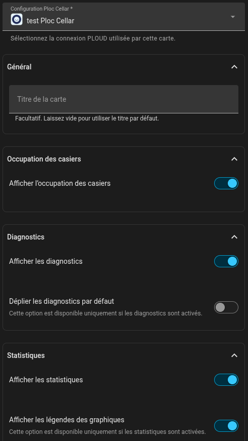
</picture>](docs/screenshots/main-card-edit.fr.png)

### - 🗃️ Edition de la carte 'Inventaire' (`custom:ploc-cellar-inventory-card`)

L'éditeur Inventaire regroupe les options générales et d'affichage.

[<picture>
   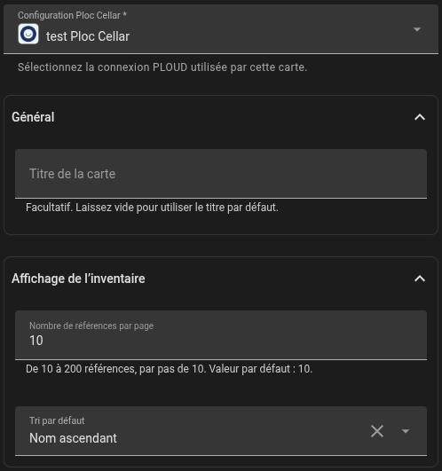
</picture>](docs/screenshots/inventory-card-edit.fr.png)

### - 🏷️ Edition de la carte 'Casier' (`custom:ploc-cellar-rack-card`)

L'éditeur Casier regroupe les réglages généraux, le format de sélection du casier (liste déroulante ou boutons) et les options d'en-tête ; l'option de barre d'occupation n'apparaît que si l'en-tête est activé.

[<picture>
   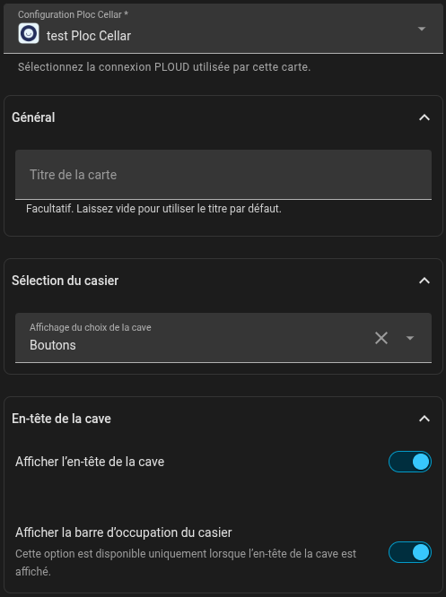
</picture>](docs/screenshots/rack-card-edit.fr.png)

---

## 🔄 Actualisation automatique

Les cartes chargent l'inventaire à leur initialisation puis s'actualisent après une synchronisation réussie par l'[intégration Ploc Cellar](https://github.com/MadMatt34/ha-ploc-cellar). Aucun polling, rafraîchissement manuel ou identifiant d'entité n'est nécessaire. Chaque carte ne reçoit que les mises à jour du compte sélectionné. Le frontend utilise la commande WebSocket `ploc_cellar/subscribe_sync`, accessible aux utilisateurs non administrateurs et limitée à l'entrée de configuration sélectionnée ; l'événement public `ploc_cellar_sync_completed` reste disponible pour les automatisations administrateur.

> [!NOTE]
> Les cartes communiquent uniquement avec Home Assistant. Elles ne se connectent pas à PLOUD et ne stockent aucun identifiant PLOC.

---

## 🛠️ Dépannage

- **Le type de carte est indisponible :** vérifier que Ploc Cellar Cards est installé via Marketplace et que la ressource `ploc-cellar-card.js` est enregistrée pour les tableaux de bord.

- **L'éditeur ne trouve aucune cave :** installer et configurer d'abord l'intégration backend, puis recharger l'éditeur du tableau de bord.

- **La carte affiche une erreur ou aucun inventaire :** vérifier l'entrée de configuration sélectionnée et consulter les journaux Home Assistant pour les erreurs de `ploc_cellar`.\

- **La carte ne s'actualise pas :** vérifier la compatibilité backend/frontend et confirmer que la carte et la synchronisation utilisent la même entrée d'intégration. Les cartes s'actualisent après une synchronisation réussie, sans polling.

[Ouvrir un suivi sur GitHub](https://github.com/MadMatt34/ha-ploc-cellar-frontend/issues/new) :\
Pour demander des fonctionnalités, indiquez le maximum de précisions.\
Pour signaler un problème, indiquer la version de Home Assistant, le navigateur, la version ou le commit frontend, le type de carte et les messages pertinents de la console du navigateur ou des journaux Home Assistant. Ne pas joindre d'identifiants ni de jetons d'accès.

---

## 🗑️ Désinstallation

1. Retirer les cartes Ploc Cellar des tableaux de bord.
2. Désinstaller **Ploc Cellar Cards** depuis Marketplace.
3. Si la ressource a été ajoutée manuellement, supprimer `/local/community/ha-ploc-cellar-frontend/ploc-cellar-card.js` des ressources du tableau de bord ; ainsi que le dossier et fichier correspondant sur le disque.\

4. Recharger le tableau de bord si besoin.

> [!IMPORTANT]
> La désinstallation des cartes ne supprime ni l'intégration backend ni son inventaire.

---

## 📚 Documentation complémentaire

- [Index de la documentation complémentaire](docs/README.fr.md)
- [Contrat backend](docs/BACKEND_CONTRACT.fr.md)
- [Instructions de développement frontend et CI](docs/DEVELOPMENT.fr.md)
- [Compatibilité backend/frontend et politique de publication](docs/COMPATIBILITY_AND_RELEASES.fr.md)

---

## 🌐 Langues prises en charge

🇬🇧 English • 🇫🇷 Français

---

## ❤️ Soutenir ce projet

Vous trouvez ce tableau de bord utile ? Ajoutez une ⭐ au projet sur GitHub !

---

## ⚖️ Licence

Ce projet est distribué sous [licence MIT](LICENSE).

---

## ⚠️ Avertissement

Ploc Cellar Cards est un frontend indépendant pour Home Assistant. Il n'est ni affilié à [PLOC](https://www.ploc.co) ou [PLOUD](https://www.ploc.co/sauvegarder-et-synchroniser), ni approuvé ou pris en charge par ces services.

L'intégration backend repose sur des interfaces PLOUD non documentées, dont le fonctionnement a été reconstitué par un travail de recherche technique indépendant. Il ne s'agit pas d'une API publique ou officiellement prise en charge, et ces interfaces peuvent évoluer ou devenir incompatibles à tout moment, sans préavis. PLOC a été contacté au sujet de ce travail et de l'existence éventuelle d'une interface officielle, mais aucune réponse n'avait été reçue au moment de la rédaction.

Les cartes frontend communiquent uniquement avec l'intégration backend Home Assistant et ne contactent jamais directement PLOUD.
