# Ploc Cellar Cards for Home Assistant

\

[❗ README en FRANÇAIS 🇫🇷 ❗](README.fr.md)

Home Assistant dashboard display (Lovelace frontend) designed for the [Ploc Cellar integration](https://github.com/MadMatt34/ha-ploc-cellar).\
🍷❤️

---

## 📦 Available cards

### - 📊 Overview (`custom:ploc-cellar-card`)

**Cellar overview, analysis and statistics**: physical and reconstructed stock, rack occupancy, stock diagnostics, and distribution charts by color, region, appellation, vintage and bottle format.\
Charts cover known wine references; occupied positions whose wine cannot be resolved remain included in the global physical totals and are reported separately.\
Selecting a diagnostic issue opens the list of wines concerned.

| Stock | Diagnostics | Statistics |
| :--: | :--: | :--: |
| 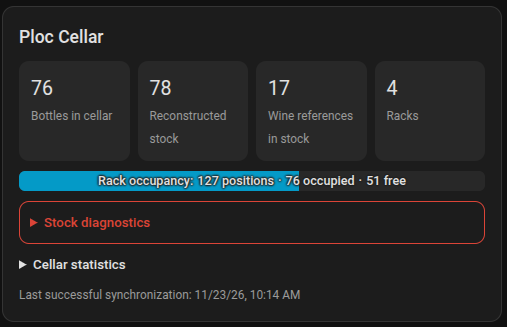 | 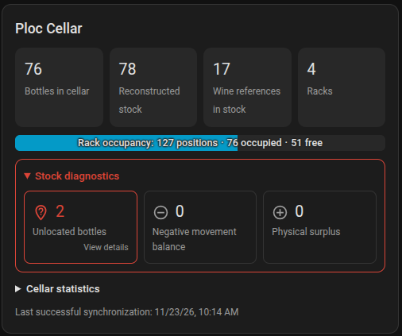 &nbsp; ↧ 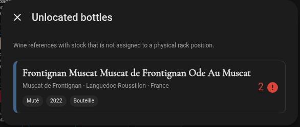 | 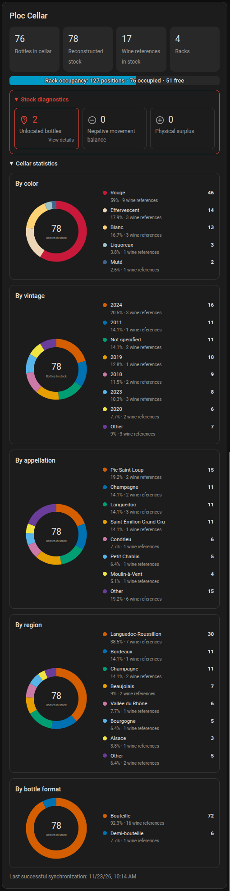 |

### - 🗃️ Inventory (`custom:ploc-cellar-inventory-card`)

**Wine list** with search, sorting and pagination, filters for color, region, appellation, vintage and food pairings.\
Color, region, appellation and vintage filters include **Unknown** to find incomplete wine records.\
Selecting a wine name opens its detailed view.

| Inventory | Search, filters and sorting |
| :--: | :--: |
| 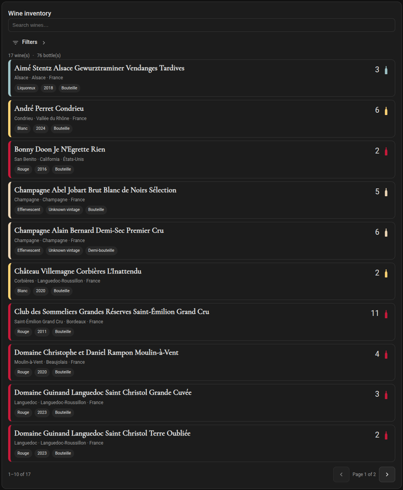 | 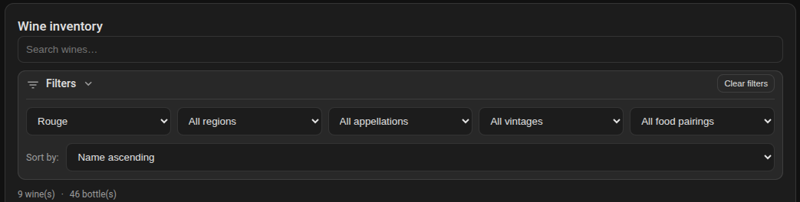 |

### - 🏷️ Rack (`custom:ploc-cellar-rack-card`)

Rack selection and **position map** based on coordinates. Each occupied position is represented individually and uses the wine color when available.\
On smaller screens, the map automatically switches to a compact touch-friendly grid. On mobile, the first tap displays the bottle tooltip; a second tap on the same position opens its detailed view.

| Large screen | Compact mode |
| :--: | :--: |
| 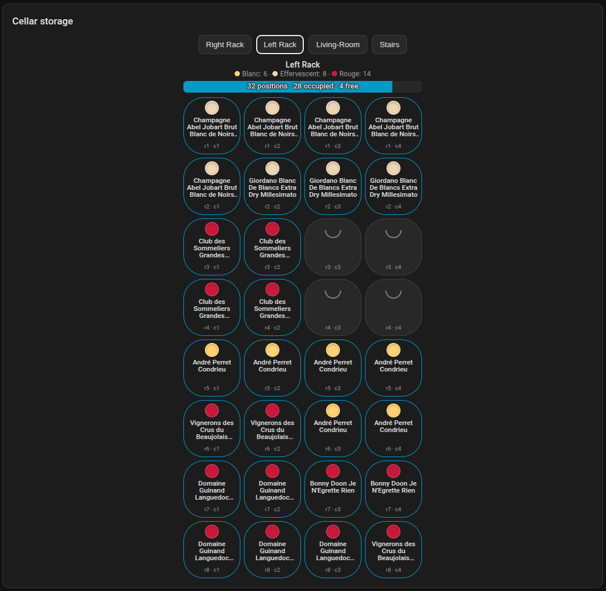 | 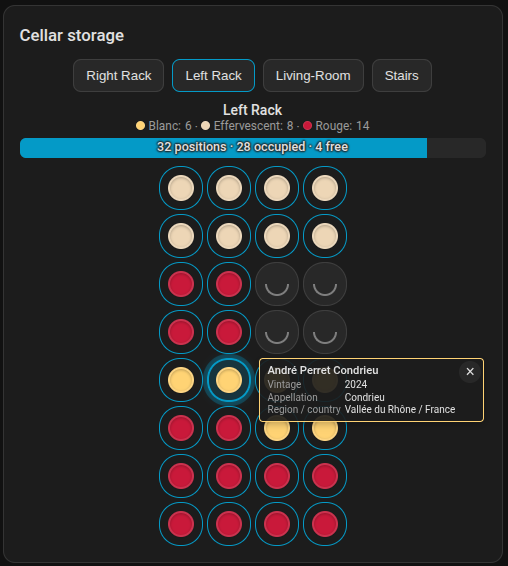 |

### - 🍷 Wine details

The **detailed wine view** opens when selecting a wine from the inventory, the diagnostics list or a rack position. It provides sections for characteristics, food pairings, notes, locations and stock.

> [!NOTE]
> Stock movements have a dedicated subsection to help identify anomalies. A visible indicator appears when an issue is detected.\
> Photos are displayed when the integration has a cached image available. The card retrieves them through an authenticated Home Assistant endpoint and does not contact PLOUD directly. The detailed view remains usable without a photo.

| Details | Characteristics | Food pairing | Locations | Stock |
| :--: | :--: | :--: | :--: | :--: |
| 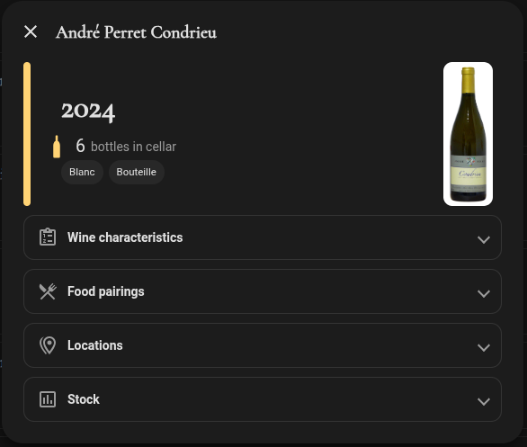 | 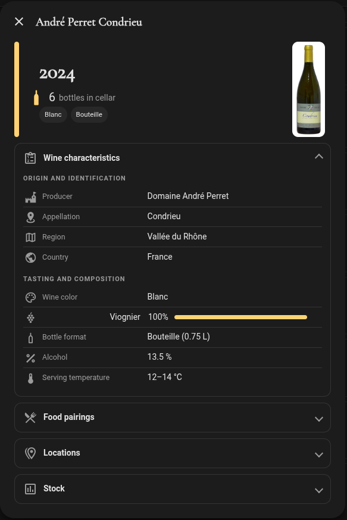 | 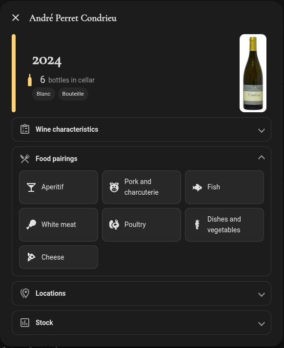 | 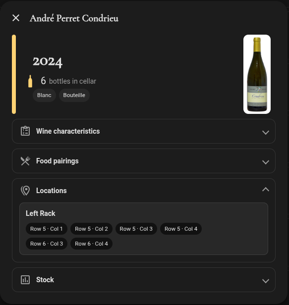 | 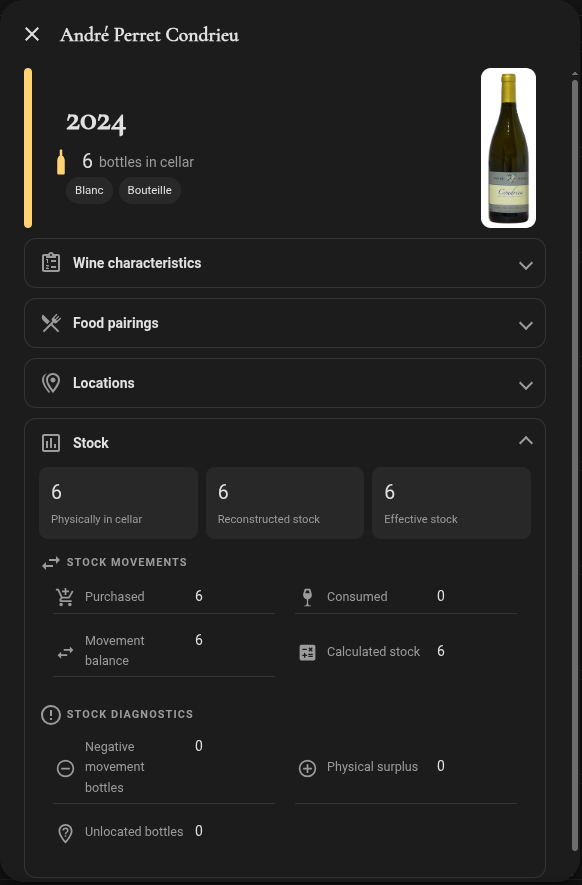 |

---

## 📋 Requirements

- [x] **The [Ploc Cellar integration](https://github.com/MadMatt34/ha-ploc-cellar) must be installed and configured in Home Assistant.**

- [x] A browser supported by the Home Assistant interface is required.

---

## 🧩 Installation

### Option 1: Installation through Marketplace (📌 recommended)

1. Open the **Ploc Cellar Cards** dashboard plugin in **Marketplace** in Home Assistant\
    

2. Click **Install**, then proceed to the configuration steps.

### Option 2: Manual installation

1. Download `dist/ploc-cellar-card.js` from this repository.

2. Copy this file to `/config/www/community/ha-ploc-cellar-frontend/`.

3. Go to **Settings** → **Dashboards**.\
   Click the ⋮ menu (top right), then select **Resources**.\
   

4. Click **Add resource** (bottom right).

5. Enter the **URL** `/local/community/ha-ploc-cellar-frontend/ploc-cellar-card.js`.\
   Select **JavaScript module**.\
   Then click **Create**.

6. Proceed to the configuration steps.

> [!NOTE]
> In case of a manuel installation, when updating, replace the JavaScript file and add or increment the version in the resource URL (for example, `?v=2.0.0`) so that the browser loads the new version.

---

## ⚙️ Card configuration

1. Add a Ploc Cellar card from the dashboard card picker.

2. Select the desired integration entry and, optionally, a card title.

### - 📊 Editing the 'Overview' card (`custom:ploc-cellar-card`)

The Overview editor groups occupancy, diagnostics and statistics into expandable sections. Diagnostics and statistics each have dependent options, displayed only when the corresponding feature is enabled.

[<picture>
   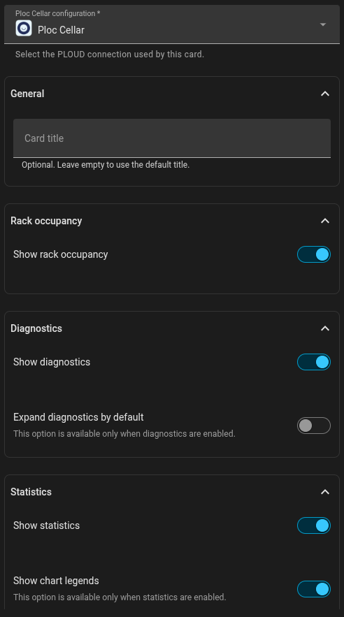
</picture>](docs/screenshots/main-card-edit.png)

### - 🗃️ Editing the 'Inventory' card (`custom:ploc-cellar-inventory-card`)

The Inventory editor groups general and display options.

[<picture>
   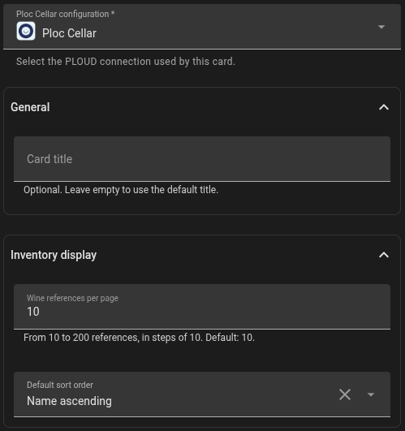
</picture>](docs/screenshots/inventory-card-edit.png)

### - 🏷️ Editing the 'Rack' card (`custom:ploc-cellar-rack-card`)

The Rack editor groups general settings, rack selection format (dropdown or buttons) and header options; the occupancy-bar option is available only when the header is enabled.

[<picture>
   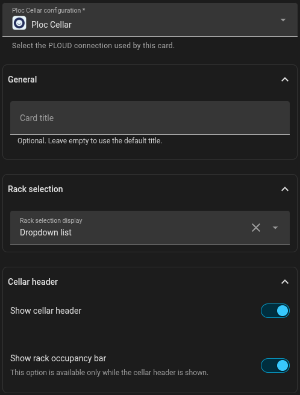
</picture>](docs/screenshots/rack-card-edit.png)

---

## 🔄 Automatic refresh

Cards load the inventory when initialized, then refresh after a successful synchronization by the [Ploc Cellar integration](https://github.com/MadMatt34/ha-ploc-cellar). No polling, manual refresh or entity ID is required. Each card receives only updates from the selected account. The frontend uses the non-admin `ploc_cellar/subscribe_sync` WebSocket command scoped to the selected configuration entry; the public `ploc_cellar_sync_completed` event remains available for administrator automations.

> [!NOTE]
> Cards communicate only with Home Assistant. They do not connect to PLOUD and do not store any PLOC credentials.

---

## 🛠️ Troubleshooting

- **The card type is unavailable:** check that Ploc Cellar Cards is installed through Marketplace and that the `ploc-cellar-card.js` resource is registered for dashboards.

- **The editor cannot find a cellar:** install and configure the backend integration first, then reload the dashboard editor.

- **The card displays an error or no inventory:** check the selected configuration entry and consult Home Assistant logs for `ploc_cellar` errors.\

- **The card does not refresh:** check backend/frontend compatibility and confirm that the card and synchronization use the same integration entry. Cards refresh after successful synchronization, without polling.

[Open an issue on GitHub](https://github.com/MadMatt34/ha-ploc-cellar-frontend/issues/new):\
For feature requests, provide as much detail as possible.\
For bug reports, include the Home Assistant version, browser, frontend version or commit, card type, and relevant browser-console or Home Assistant log messages. Do not attach credentials or access tokens.

---

## 🗑️ Uninstallation

1. Remove Ploc Cellar cards from dashboards.
2. Uninstall **Ploc Cellar Cards** from Marketplace.
3. If the resource was added manually, remove `/local/community/ha-ploc-cellar-frontend/ploc-cellar-card.js` from dashboard resources, as well as the corresponding folder and file from disk.\

4. Reload the dashboard if needed.

> [!IMPORTANT]
> Uninstalling the cards does not remove the backend integration or its inventory.

---

## 📚 Additional documentation

- [Additional documentation index](docs/README.md)
- [Backend contract](docs/BACKEND_CONTRACT.md)
- [Frontend development instructions and CI](docs/DEVELOPMENT.md)
- [Backend/frontend compatibility and release policy](docs/COMPATIBILITY_AND_RELEASES.md)

---

## 🌐 Supported languages

🇬🇧 English • 🇫🇷 Français

---

## ❤️ Support this project

If you find this dashboard useful, give the project a ⭐ on GitHub!

---

## ⚖️ License

This project is distributed under the [MIT License](LICENSE).

---

## ⚠️ Disclaimer

Ploc Cellar Cards is an independent Home Assistant frontend. It is not affiliated with [PLOC](https://www.ploc.co) or [PLOUD](https://www.ploc.co/sauvegarder-et-synchroniser), nor endorsed or supported by either service.

The backend integration relies on undocumented PLOUD interfaces, whose operation was reconstructed through independent technical research. This is not a public or officially supported API, and these interfaces may change or become incompatible at any time without notice. PLOC has been contacted regarding this work and the possible existence of an official interface, but no response had been received at the time of writing.

The frontend cards communicate only with the Home Assistant backend integration and never contact PLOUD directly.
